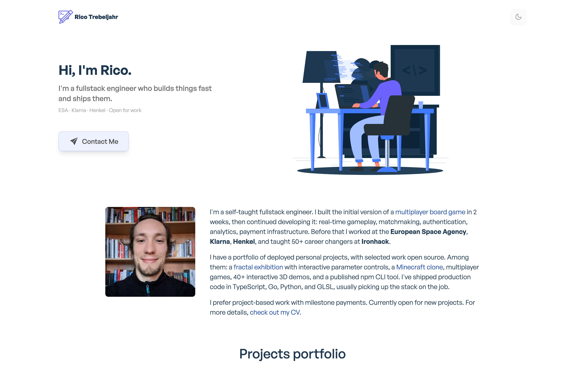
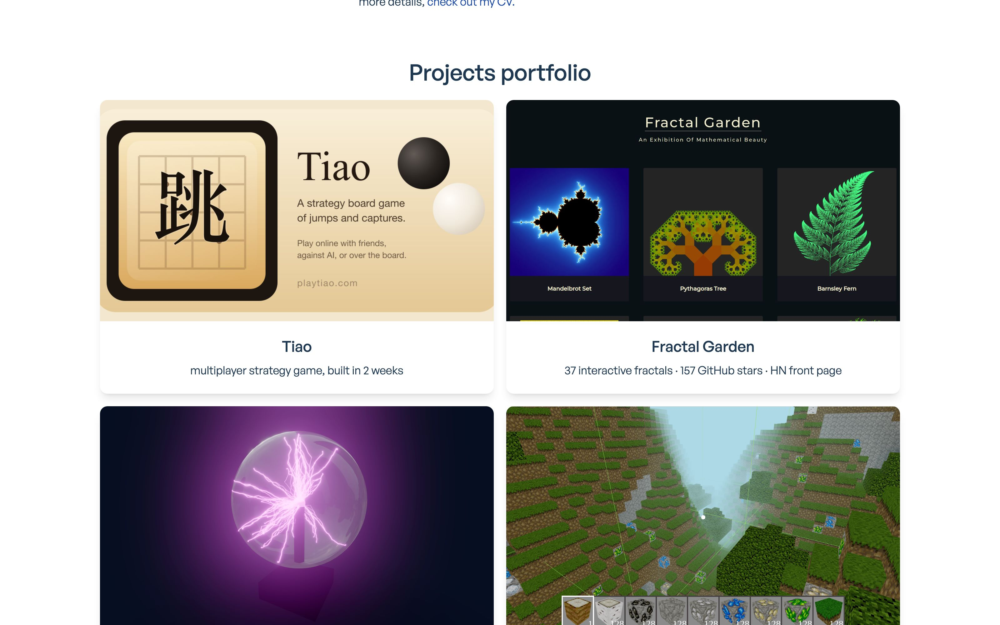

# portfolio.trebeljahr.com

[](LICENSE)
[](https://github.com/trebeljahr/portfolio.trebeljahr.com/actions/workflows/deploy.yml)



The portfolio of Rico Trebeljahr, a full-stack engineer. If you want to hire him or see what he builds, it puts his projects, his CV and a contact form on one site.

Each project card links to the project: a multiplayer board game, a fractal exhibition, a Minecraft clone, 3D demos and command-line tools. The CV page lists his work history, and the contact form sends him an email.

Visit it at **[portfolio.trebeljahr.com](https://portfolio.trebeljahr.com)**.



## Stack

- **Framework:** Next.js 16 (Pages Router), static export (`output: "export"`)
- **UI:** React 19, Tailwind CSS 3, Framer Motion 11
- **Language:** TypeScript 6
- **PWA:** @ducanh2912/next-pwa
- **Deployment:** Cloudflare Workers Static Assets, on every push to `main` (`.github/workflows/deploy.yml`)
- **Forms:** shared `forms-api` Worker (see [`workers/forms`](workers/forms/README.md))

## Run it locally

You need Node.js 24 (see `.node-version`) and pnpm.

```bash
pnpm install
pnpm dev
```

Open [http://localhost:3801](http://localhost:3801).

## Project structure

```
components/
  about/        # Bio, client logos, stats
  contact/      # Contact form (posts to the forms Worker)
  logos/        # SVG company logos (ESA, Klarna, Henkel, flowkey, Ironhack, Softgames)
  projects/     # Project grid and cards
  shared/       # Header, footer, banner
  layout/       # Page layout wrapper
data/
  projectsData.ts   # Project definitions
pages/
  index.tsx     # Home
  cv.tsx        # CV / resume
  imprint.tsx   # Legal notice
  privacy.tsx   # Every host the browser contacts and every key it stores
workers/
  forms/        # Shared forms Worker, deployed separately, not part of the site build
docs/marketing/ # Screenshots and social preview images (see its README)
```

## Configuration

Copy `.env.example` to `.env.local`. Every `NEXT_PUBLIC_*` value is inlined into
the static export at build time, so changing one needs a rebuild and redeploy.

| Variable | Default | Purpose |
|---|---|---|
| `NEXT_PUBLIC_CONTACT_ENDPOINT` | `https://forms-api.ricoslabs.workers.dev/contact` | Absolute URL of the contact form endpoint |

## Contact form

The static export ships no API routes, so the form posts to the shared
`forms-api` Worker instead of a local `/api/contact`. That Worker holds the
Listmonk credential, validates and rate-limits submissions, and is deployed on
its own. `pnpm build` does not touch it.

The origin the form is served from must be in the Worker's allowlist
(`workers/forms/src/lib/cors.ts`), including `localhost` for development.

Setup and deployment: [`workers/forms/README.md`](workers/forms/README.md).

## Privacy page

`/privacy` names every host a visitor's browser contacts and everything the site
stores in the browser. A new third-party request (script, font, image, embed,
`fetch` call), a new storage key, or another host in `NEXT_PUBLIC_CONTACT_ENDPOINT`
updates `pages/privacy.tsx` and its `UPDATED_ON` in the same change.

## Scripts

| Command | Description |
|---------|-------------|
| `pnpm dev` | Start the dev server on port 3801 |
| `pnpm build` | Generate SEO files, then write the static site to `out/` |
| `pnpm lint` | Run Biome |
| `pnpm analyze` | Bundle analysis |

## License

The code is licensed under the [MIT License](LICENSE). The site started from Nangialai Stoman's MIT-licensed [nextjs-tailwindcss-portfolio](https://github.com/realstoman/nextjs-tailwindcss-portfolio) template.

The licence covers code only. Rico's writing, photos and CV are © Rico Trebeljahr, all rights reserved. Third-party assets keep their own licences and rights: the General Sans font (Indian Type Foundry, from Fontshare) and the company logos, which belong to their owners.

## Support

You can support Rico's open work at [ricos.site/donate](https://ricos.site/donate).
